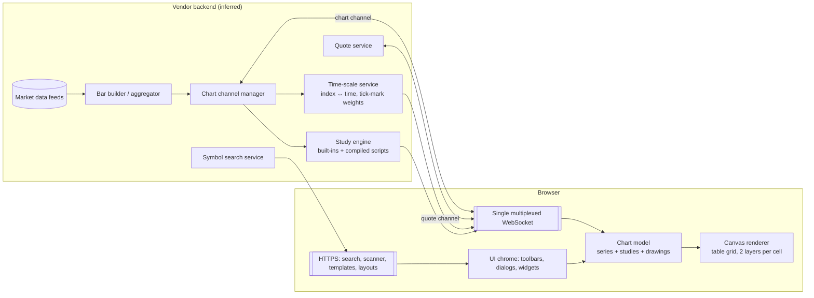
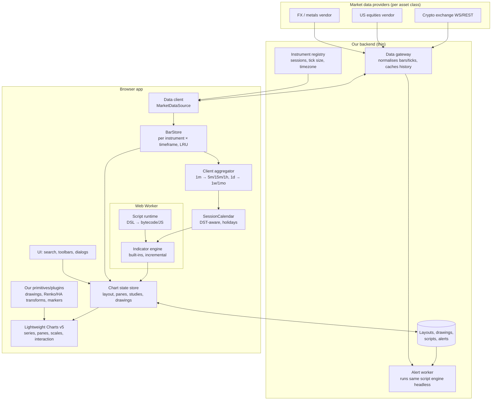
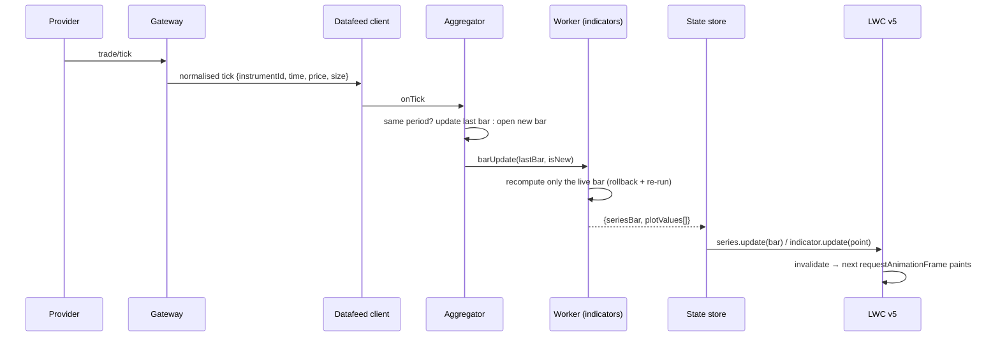

# Architecture Overview — Clean-Room Study

This document describes how a professional web charting platform behaves, based on watching the
public chart page (`/chart/`) in a free, logged-out browser session. It then proposes an **original**
architecture for our own platform, built on **Lightweight Charts v5 (Apache-2.0)** plus our own modules.

> Clean-room rules followed: no source code, bundles, shaders, CSS, icons, fonts or market data were
> copied. Network messages were reduced to **value-free shapes** (method names, key names, array
> lengths, value *types*, and relative timing) before analysis. Everything below is written in our own words.

---

## 1. How the evidence was gathered
> **Confidence:** VERIFIED (record of what was done in the study session).

| Pass | Tool | What it established |
|---|---|---|
| A | REA `inspect_web_page` (passive, 3 s) | DOM skeleton (node names + attribute *names* only), storage key names, script count |
| B | REA `capture_browser_scenario` (page load, 15 s) | Full HTTP origin map, WebSocket handshake + session setup sequence |
| C | REA `capture_browser_scenario` (27 keyboard steps, 70 s) | Timeframe change, symbol search → symbol switch, 40 s of realtime updates, heartbeat |
| D | REA `inspect_web_page` (75 s) + input driver | HTTP JSON **shapes** for symbol search & symbol info; keystroke/abort behaviour |
| E | DevTools input driver + in-process shape recorder | Mouse-wheel zoom, drag-pan → history pagination, view reset, script-editor login gate |

Pass E exists because REA's scripted actions have no mouse-wheel/drag, and its passive capture cannot
see a WebSocket opened before it attaches. The driver turned each frame into a shape in memory before
writing it, so no values were stored.

**Confidence labels used throughout:** **Observed** = seen directly in captures or screenshots ·
**Inferred** = reasoned from observed shapes or timing · **Design** = our own proposal.

---

## 2. What we observed (summary ledger)
> **Confidence:** every O-row is INFERRED in the review taxonomy. Each was observed once, in one free logged-out session, from one region, and cannot be confirmed against public vendor documentation. O16–O18 are also consistent with how Lightweight Charts works (VERIFIED for LWC, not for the vendor).

| # | Finding | Label | Evidence |
|---|---|---|---|
| O1 | All market data (bars, quotes, *indicator values*) flows over **one multiplexed WebSocket** . Frames are length-prefixed text, each carrying a JSON object with a method name and a positional parameter array | Observed | B, C |
| O2 | Connection setup order: server hello (connection id and version info) → client authenticates (anonymously when logged out) → client sets locale → client opens a chart data channel and several quote subscription groups | Observed | B |
| O3 | Symbol lookup is a separate request/response, done once per symbol before any data is requested. The metadata covers price precision and tick size, an optional fractional-price format, an optional variable tick-size table, exchange timezone, regular-session and sub-session (pre/post-market) definitions, a holiday list, capability flags (intraday available, extended hours available), instrument type and tags, currency and exchange | Observed | B, C |
| O4 | A *series* is created with a timeframe identifier and an **initial bar count of 300** | Observed | B, C |
| O5 | Each bar arrives as a (bar index, [time, open, high, low, close, volume]) tuple: **index-based**, contiguous from 0, times strictly increasing | Observed (derived) | C |
| O6 | The **time axis is computed server-side**. Each bar is sent with a label-importance level, plus "future" tick marks for the empty area right of the last bar | Observed (derived) | C |
| O7 | Label-importance levels are graded from minute boundaries up through hour, day, week and month to year boundaries. A higher level wins when labels compete for space | Observed (derived) | C |
| O8 | **Indicators are computed server-side.** A create-study request is answered by a loading notice, a data update with per-study point arrays, then a completed notice. Volume behaves as a study, not as series data | Observed | B, C |
| O9 | Changing the timeframe *modifies the existing series* (no new session). The server clears the series (empty update), resends 300 bars and recomputes every attached study | Observed | C, E |
| O10 | Realtime: about one data update per second while price moves. **Each update carries one bar with the same index and time as the last bar, so the current bar is updated in place.** A study update is sent with every series update | Observed (derived) | C, E |
| O11 | Liveness: an HTTP `ping` every **10.0 s** to the data host, plus a WebSocket heartbeat frame from the server (also ~10 s) that the client **echoes back** | Observed | C, E |
| O12 | **History pagination:** when panning reaches the left edge, the client sends a request for more history and receives a **~145-bar chunk** (series and studies together) within ~300 ms. One request is in flight at a time, about one per 2 s of continuous panning | Observed | E |
| O13 | Symbol search is a **plain HTTPS GET** to a dedicated search service. It takes query text plus exchange, instrument-type, language and grouping filters. One request per keystroke; superseded requests are **cancelled** (21 of 24 aborted) | Observed | C, D |
| O14 | Search results are grouped by instrument, with alternate venues and futures contracts nested under each result. Each result has exchange, type, tags, currency, a logo reference, a data-provider reference and security identifiers (ISIN/CUSIP) | Observed | D |
| O15 | Session gaps appear in **times only, never in indexes**. US stock daily bars show 1/2/3/4-day steps (weekends, holidays) **and ±1 h steps at DST transitions**. Hourly shows 18 h overnight gaps; crypto shows uniform steps (24/7) | Observed (derived) | C |
| O16 | The chart is laid out as an **HTML table**: one row per pane, cells for pane and price axes, **two stacked canvases per cell** (main and overlay) | Observed | A |
| O17 | Mouse-wheel zoom **anchors at the right edge (latest bar) by default**; the UI hints that holding ⌘ keeps the chart position | Observed | E (screenshot) |
| O18 | Drag-pan scrolls back through history; the price scale auto-fits the visible bars; a "reset view" shortcut returns to the latest bar with a right offset | Observed | E (screenshots) |
| O19 | The last-price label shows a **countdown to bar close**. The bar payload includes the bar's close time | Observed | C, screenshot |
| O20 | Last symbol, timeframe and chart style persist in browser local storage, and panel sizes and toolbar state in session storage. They restore on reload | Observed | A, E |
| O21 | Saved study templates come from an HTTP endpoint; chart layouts are saved to a separate storage service (login required) | Observed / Inferred | B |
| O22 | Adding a script from the vendor's script editor to the chart **requires login**. Compilation was **not observed** | Observed (gate) | E |
| O24 | Quote subscription groups (watchlist, header, details) are separate subscriptions with their own field lists. The client **pauses** a group when its panel is hidden | Observed | B |

### Not observed (open questions)
- Script compile request/response shape (gated by login, O22).
- Alert creation and evaluation (needs an account).
- Server-side layout save/load payloads (needs an account).
- Renderer internals such as redraw scheduling, dirty regions and DPI math. Only the canvas structure was observable, so the rendering design follows Lightweight Charts' documented model.

---

## 3. Their architecture as inferred from behaviour
> **Confidence:** INFERRED.

Key takeaway: **their client is mostly a thin renderer.** Bars, indicator values and even time-axis
label weights are produced on the server. For our platform that is a choice, not a requirement, and we
deliberately move most computation **into the client** (see §4).

---

## 4. Our proposed architecture (Design)
> **Confidence:** DESIGN. Canonical names follow `data-feed-spec.md §2` and `indicator-engine-spec.md §2`.

### Data path from source to pixels (realtime tick)

### Module boundaries

| Module | Responsibility | Built on |
|---|---|---|
| `datafeed` | `MarketDataSource` interface, provider adapters, history paging, bar streams | Our code (see `data-feed-spec.md`) |
| `bars` | `BarStore`, dedupe/validation, aggregation, `SessionCalendar`, chart-type transforms | Our code |
| `chart-core` | Panes, series, scales, interaction | **LWC v5** |
| `chart-plugins` | Drawings, Heikin-Ashi/Renko transforms, countdown label, session shading | LWC primitives + custom series |
| `indicators` | Built-in studies, incremental computation | Our code, in a Web Worker |
| `quill` | Quill compiler + runtime | Our code, in a Web Worker |
| `state` | Layout/drawings/settings persistence, multi-chart sync | Our code plus backend |
| `alerts` | Server-side evaluation of the same scripts | Our code (Node worker) |

### Main differences from what we observed (deliberate)
1. **Indicators run client-side in a worker**, not on the server. This gives no per-study server cost, works offline with cached bars, and fits a single-team build. Server-side evaluation is kept only for alerts.
2. **Time-axis labels are computed client-side** by LWC from bar times. We only supply a timezone-aware `tickMarkFormatter`.
3. **The datafeed is an interface** with one adapter per provider, not a proprietary protocol. We can still copy the useful *patterns*: one multiplexed socket, subscription ids, chunked history, heartbeat echo, and a clear-then-reload on timeframe change.
