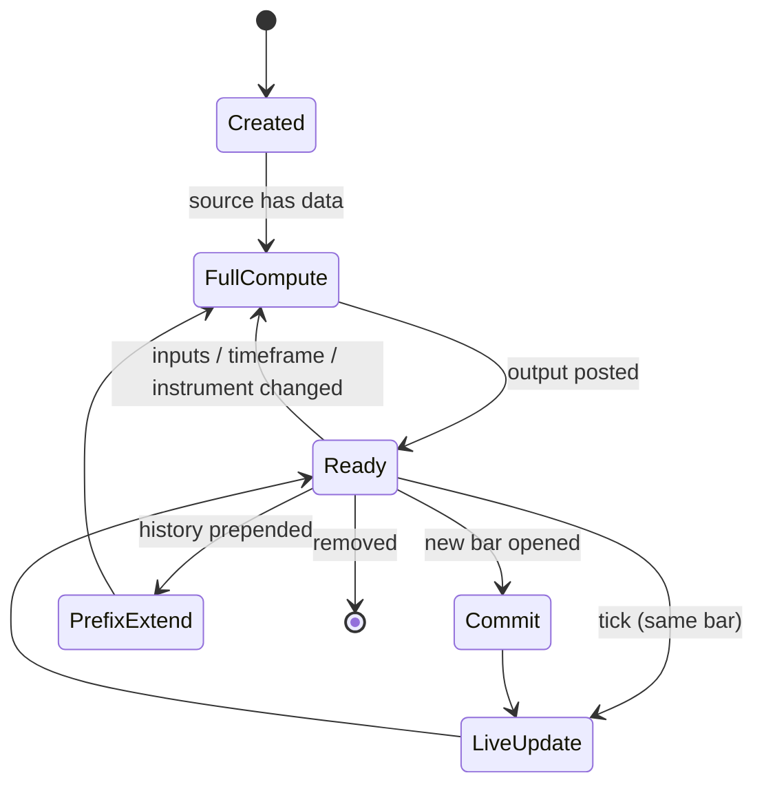

# Indicator Engine Specification

Covers indicators, their lifecycle, multi-timeframe alignment and alerts. §8 also covers **chart
state, layouts and multi-chart sync**.

Canonical names: `IndicatorDefinition`, `InputDef`, `PlotDef`, `IndicatorInstance`, `IndicatorOutput`
(this doc); `Timeframe`, `Bar`, `InstrumentId` (`data-feed-spec.md §2`); `none` ↔ `NaN` in output
columns. Quill scripts (`script-language-design.md`) compile to these same types, so built-ins and user
scripts are handled identically.

---

## 1. What we observed
> **Confidence:** INFERRED (observed in captures; internal behaviour not independently confirmable).

| Obs | Detail |
|---|---|
| O8 | Indicators are created per chart with an id, a source reference (the series), an indicator identifier and an inputs object. The server answers loading → data → completed |
| O8 | Output is one tuple per bar keyed by bar index: `[time, value1, value2, …]`, one column per plot. Seen widths: 3, 4 and 8 plot columns |
| O9 | On timeframe change, **every indicator is recomputed** after the series reloads |
| O10 | Each realtime series update comes with one indicator point at the same index (**live-bar recompute**) |
| O12 | On history paging, each indicator receives a chunk the same size as the series chunk (**prefix recompute**) |
| — | Volume is implemented as an indicator, not as a series field |

The reference engine runs server-side. **Ours runs client-side in a Web Worker** (DESIGN, architecture §4), with the same observable contract.

## 2. Data model
> **Confidence:** DESIGN.

```ts
interface IndicatorDefinition {
  id: string;                              // "rsi", "user:abc123"
  name: string; shortName: string;
  overlay: boolean;                        // true → main pane; false → new pane
  format: { type: 'price' | 'volume' | 'percent' | 'inherit'; precision?: number };
  inputs: InputDef[];                      // drives the generated settings UI
  plots: PlotDef[];
  levels?: { id: string; value: number; title: string; color?: string; dash?: number[] }[];   // e.g. RSI 30/70
  fills?: { between: [string, string]; color: string }[];                                    // plot or level ids
  priceScale?: { id?: string; mode?: 'normal' | 'log' | 'percent'; fixedRange?: [number, number] };
  warmup: number | 'auto';                 // bars before the first valid output (see script-language-design §8.1)
  requires?: { timeframe?: Timeframe; instrumentId?: InstrumentId }[];   // other-timeframe / other-instrument data
}

type InputDef =
  | { id: string; type: 'int' | 'float'; default: number; min?: number; max?: number; step?: number; title: string }
  | { id: string; type: 'bool'; default: boolean; title: string }
  | { id: string; type: 'source'; default: 'close' | 'open' | 'high' | 'low' | 'hl2' | 'hlc3' | 'ohlc4' | `plot:${string}`; title: string }
  | { id: string; type: 'choice'; options: string[]; default: string; title: string }
  | { id: string; type: 'timeframe'; default: Timeframe; title: string }
  | { id: string; type: 'instrument' | 'color' | 'string'; default: string; title: string };

interface PlotDef {
  id: string; title: string;
  kind: 'line' | 'step' | 'histogram' | 'area' | 'bars' | 'dots' | 'plus' | 'shape';
  color: string | { dynamic: true };       // dynamic → per-bar colour column
  lineWidth?: number;
  offset?: number;                         // shift plot by N bars
  display?: 'all' | 'pane-only' | 'values-only' | 'hidden';
}
// Background shading and bar colouring are separate outputs (Quill `shade` / `paint`), not plot kinds.

/** Columnar output, transferable to the main thread with zero copy. */
interface IndicatorOutput {
  firstIndex: number;                      // bar index of element 0
  columns: Record<string /*plotId*/, Float64Array>;   // NaN = none (gap)
  colors?: Record<string, Uint32Array>;    // per-bar RGBA for dynamic colours
  shade?: Uint32Array;                     // per-bar background colour (0 = none)
  paint?: Uint32Array;                     // per-bar candle colour override (0 = none)
  marks?: { index: number; text: string; position: 'above' | 'below'; color: string }[];
  events?: { index: number; alertId: string }[];      // alert conditions that fired
}
```

An **`IndicatorInstance`** = definition + input values + a source binding (series or another instance's
plot) + pane/scale assignment + visibility.

**Rendering mapping:** each plot → one LWC series (`LineSeries`, `HistogramSeries`, `AreaSeries`, or a
custom series for `dots`/`plus`/`shape`). `NaN` values are sent as **whitespace items** `{ time }`, never as
NaN (`rendering-and-interaction.md §8`). Marks use `createSeriesMarkers`. Fills, `shade` and `paint`
use our primitives.

## 3. Calculation lifecycle
> **Confidence:** DESIGN. The rollback behaviour matches O10 (INFERRED).



### 3.1 Full compute
Run bar by bar from index 0 to the last index. Cost is O(N · k). With N = 20 000 bars and typical
indicators, the target is < 5 ms in a worker (a target to measure, not a verified number).

### 3.2 Warm-up and `none`
Every built-in has a documented **first valid index** (`script-language-design.md §8.1`, conventions
VERIFIED against published formulas). Before that index, outputs are `none` (`NaN`). Rules:
- An EMA is seeded with the SMA of its first n values, so EMA-based outputs start at index n−1 (MACD line: 25; signal: 33 for 12/26/9).
- RSI needs n+1 prices, so the first value is at index n (14).
- ATR uses H−L for bar 0's true range, so the first value is at index n−1.
- A `none` input inside a window makes that window's output `none`.
- Recursive smoothers (EMA, RMA) are **not** reset by `none`. They hold their last state and resume. This is DESIGN; it is documented per function.

### 3.3 Live bar update (no repainting of history)
Each indicator keeps **two-level state**:
- `committed`: state after the last *closed* bar.
- `scratch`: copy of `committed`, mutated while evaluating the live bar.
```
onTick(liveBar):     scratch = clone(committed); out[last] = step(scratch, liveBar)
onNewBar(closed, live): committed = step(committed, closed); then onTick(live)
```
Each tick rewinds to the state at the start of the bar. Values on the live bar can change, but
**closed bars never change**. Quill `tick` variables are excluded from the rollback.

### 3.4 Prefix extension (history paging, O12)
Prepending history changes everything after it for recursive indicators (EMA, RSI, ATR). Policy:
1. Recompute from 0 over the merged array in the worker (simplest correct option).
2. Optimisation for finite-window indicators (SMA, highest, lowest, Bollinger): recompute only `[0, oldFirst + warmup)` and splice. Recursive indicators always recompute fully.

### 3.5 Implementation notes
- Ring buffers sized to the window. `sma` keeps a running sum, and `highest`/`lowest` a monotonic deque, so each is O(1) amortised per bar.
- Post outputs as transferable `ArrayBuffer`s. For live ticks post only `{ index, values }`.

## 4. Stacking, panes and scales
> **Confidence:** DESIGN using LWC v5 pane and scale APIs (VERIFIED).

| Rule | Behaviour |
|---|---|
| `overlay: true` | Main pane. Shares the main price scale when `format.type` is `price`/`inherit`; otherwise gets an overlay scale `priceScaleId: 'ind-<id>'` |
| `overlay: false` | New pane: `chart.addPane()`, then `pane.setStretchFactor(0.25)` relative to the main pane's 1.0 |
| Move between panes | `series.moveToPane(i)` / `pane.moveTo(i)` |
| Order | z-order = insertion order. The **layers panel** can reorder |
| Volume | Main-pane overlay, own scale, margins `{ top: 0.8, bottom: 0 }` |
| Fixed-range indicators (RSI, Stochastic) | `autoscaleInfoProvider` returns `[0, 100]`; levels at 30/70 or 20/80 |

## 5. Indicator on indicator
> **Confidence:** DESIGN.

A `source` input can be `plot:<instanceId>.<plotId>`. The engine keeps a **dependency DAG**:
- Topologically sort. On any update, evaluate in topological order and pass A's output column to B as its source.
- Reject cycles when binding, with a UI error.
- B defaults to A's pane, and gets its own scale if the units differ.

## 6. Multi-timeframe (MTF) alignment
> **Confidence:** DESIGN. The no-look-ahead principle is standard backtesting practice.

The goal: evaluate an expression on a **higher timeframe (HTF)** and map it onto chart bars **without
look-ahead**.

```
C[0..n): chart bars; H[0..m): HTF bars; both sorted by open time.
j(i) = last j with H[j].time ≤ C[i].time   (session-aware bucketStart on the HTF timeframe)

Confirmed mode (default, never repaints):
   value_i = htf[j(i) − 1]             // the last fully closed HTF bar
Live mode (live=true, repaints on the live bar only):
   value_i = htfPartial(j(i), i)        // the forming HTF bar as it stood at C[i]'s close
```
Live mode **reconstructs** the partial HTF bar from chart bars `[start(j), i]`: open = first open,
high = max, low = min, close = C[i].close, volume = sum. The HTF expression runs on it with rollback.
This reproduces what a live user saw and avoids the classic MTF repaint bug.

Requesting a lower timeframe than the chart's returns an **array per chart bar** (intrabar values).

Implementation:
1. The worker asks the main thread for HTF bars covering the chart's range (`BarStore`, `loadHistory`).
2. Build `j(i)` in one merge pass, O(n + m).
3. Evaluate the HTF sub-program in its own context (`committed`/`scratch`), stepping it as `j` advances.

## 7. Alerts
> **Confidence:** DESIGN. Not observable on the reference platform (needs an account).

```ts
interface AlertRule {
  id: string; instrumentId: InstrumentId; timeframe: Timeframe;
  condition:
    | { type: 'cross' | 'crossUp' | 'crossDown' | 'above' | 'below' | 'enterRange' | 'exitRange';
        left: ValueRef; right: ValueRef | number }
    | { type: 'script'; alertId: string };    // a Quill `alert` statement
  frequency: 'once' | 'oncePerBar' | 'onceOnBarClose' | 'everyTick';
  expiresAt?: number; message: string; channels: ('push' | 'email' | 'webhook')[];
}
type ValueRef = { kind: 'price'; field: 'close' | 'high' | 'low' } | { kind: 'plot'; instanceId: string; plotId: string };
```
- **Evaluated server-side** in the alert worker, so alerts fire with the browser closed. It uses the *same* indicator/Quill engine (an isomorphic TS package) on the gateway's realtime bars.
- Crossing: `prev ≤ level && cur > level` (crossUp), where `prev` is the committed previous value.
- `onceOnBarClose` evaluates only at Commit. `oncePerBar` dedupes by `(alertId, barIndex)`. `everyTick` is rate-limited (1 per 5 s per alert).
- Persist `lastFiredBarTime`, so restarts never double-fire.

## 8. Chart state, layouts and multi-chart sync
> **Confidence:** observations INFERRED (O20, O21, O24); document format and sync are DESIGN.

### Observed
- Last symbol, timeframe and chart style persist in **browser local storage** and restore on reload. Panel and toolbar state lives in **session storage**.
- Indicator templates are fetched over HTTP. Named layouts go to a storage service (account only; not observed).
- Quote subscriptions for hidden panels are **paused**.

### Our layout document (versioned JSON)
```jsonc
{
  "schema": 1,
  "id": "lay_…", "name": "BTC scalping", "updatedAt": "<timestamp>",
  "grid": { "template": "2x2", "sizes": [[0.5,0.5],[0.5,0.5]] },
  "sync": { "instrument": true, "timeframe": false, "crosshair": true, "time": true, "drawings": "per-instrument" },
  "charts": [{
    "id": "c1", "instrumentId": "COINBASE:BTC-USD", "timeframe": "5m", "chartType": "candles",
    "timeScale": { "barSpacing": 8, "rightOffset": 6 },
    "panes": [{ "id": "main", "stretch": 1 }, { "id": "p2", "stretch": 0.25 }],
    "indicators": [{ "id": "i1", "definition": "rsi", "inputs": { "len": 14 }, "pane": "p2", "visible": true }],
    "styleOverrides": { "upColor": "$up", "downColor": "$down" }
  }],
  "drawingsRef": "drw_…"       // drawings are stored separately, keyed by user × instrument
}
```
- Write path: state store → 1 s debounce → local storage (instant restore) → backend `PUT /layouts/:id` with `If-Match: <etag>` for conflict detection.
- Migrations: a `schema` number plus pure upgrade functions (`v1→v2→…`).
- Drawings are stored per user × instrument, so they appear on every chart showing that instrument.

### Multi-chart sync
A `LayoutBus`: an in-process event emitter, plus `BroadcastChannel` across tabs.

| Event | Payload | Applied by charts where | LWC call |
|---|---|---|---|
| `instrument` | `InstrumentId` | `sync.instrument` and same link group | reload series |
| `timeframe` | `Timeframe` | `sync.timeframe` | reload series |
| `crosshair` | `{time, price?}` | `sync.crosshair` | `setCrosshairPosition(price, time, series)` / `clearCrosshairPosition()` |
| `visibleTimeRange` | `{from, to}` | `sync.time` | `timeScale().setVisibleRange()` (time-based, works across timeframes) |

Loop guard: each event carries `originChartId`, and charts ignore their own echoes.
