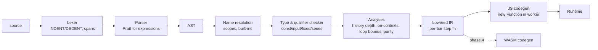

# Script Language Design ("Quill")

An **original** domain-specific language for indicators, strategies and alerts. *Quill* is a
placeholder name. It offers bar-by-bar series semantics, a common idea in trading DSLs, but its
syntax, keywords, standard-library names and runtime are our own design.

Canonical cross-doc names used here: `Timeframe` (`"5m"`, `"1d"` …, from `data-feed-spec.md §2`),
`IndicatorDefinition` / `InputDef` / `PlotDef` / `IndicatorOutput` (from `indicator-engine-spec.md §2`),
and `none` for a missing value (stored as `NaN` in output columns).

---

## 1. What we could observe about the reference platform
> **Confidence:** observation rows are INFERRED or UNKNOWN (login gate); nothing here is required by our design.

| Question | Finding | Class |
|---|---|---|
| Is compilation server-side or client-side? | **Not observed.** In a logged-out session the editor opens, but adding a script to the chart shows a login wall (O22). No compile request was sent | UNKNOWN |
| Where do scripts execute? | Probably server-side. All built-in studies execute on the server and stream values over the chart WebSocket (O8), and the server hello advertises version info for its study runtime | INFERRED |
| Output format | Per-bar tuples `[time, plot1..plotN]` keyed by bar index were observed for built-ins (O8). A script's plots are expected to use the same transport | INFERRED |
| Input UI | The indicator dialog lists built-ins, personal and community scripts. Inputs are edited in a generated settings dialog | VERIFIED (observed in a screenshot) |

The compile request/response shape is listed in `review/open-questions.md`. Our design does not depend on it.

## 2. Design goals
> **Confidence:** DESIGN.

1. **Series-first:** every value is implicitly a time series. `x[1]` is the previous bar's `x`.
2. **Deterministic and sandboxed:** no I/O, no clock, no randomness except a seeded `rand`, bounded loops and memory.
3. **One engine everywhere:** the browser worker (charts), Node (alerts, backtests) and tests.
4. **Fast:** compile to JS functions (WASM later) over typed arrays, with no interpreter overhead per bar.
5. **Friendly errors** with source spans and suggestions.

## 3. Language overview
> **Confidence:** DESIGN.

```quill
indicator "SMA Cross" overlay              // header: kind + name + flags

input fast = int(9,  "Fast length", min=1)
input slow = int(21, "Slow length", min=1)
input src  = source(close, "Source")

let f = sma(src, fast)                     // `let` = recomputed every bar
let s = sma(src, slow)

plot f "Fast" color=$accent1
plot s "Slow" color=$accent2

when crossover(f, s)  mark "▲" at=below color=$up
when crossunder(f, s) mark "▼" at=above color=$down
alert crossover(f, s) "Fast crossed above slow on ${symbol}"
```

### Keywords
`indicator`, `strategy`, `library` · `input` · `let` (per bar) · `keep` (persists across bars,
initialised on bar 0) · `tick` (persists across ticks within the live bar, i.e. **not** rolled back) ·
`fn` · `if/elif/else` · `for … in …` · `while` (bounded) · `return` · `plot`, `level`, `fill`, `mark`,
`paint` (bar colour), `shade` (background) · `alert` · `when` · `none` · `true/false` · `import`.

### Types
`int`, `float`, `bool`, `string`, `color`, plus `series<T>` (implicit), `array<T>`, `map<K,V>`, `tuple`.
`none` belongs to every type. Qualifiers by *update frequency* are inferred, never written:
`const` < `input` < `fixed` (constant for one run) < `series` (varies per bar). Some parameters require
`fixed` or lower (e.g. `sma(src, length)` needs a `fixed` length), and the checker enforces this.

### Colours and message templates
- Colours are hex literals (`#1e88e5`) or **palette tokens** (`$up`, `$down`, `$accent1` … `$accent6`, `$muted`) that resolve through the app theme, so scripts follow light/dark mode. `color/alpha` sets opacity, e.g. `$accent1/10` = 10 % opacity.
- Alert messages use `${…}` templates: `${symbol}`, `${timeframe}`, `${close}`, `${time}`, `${plot.<title>}`.

## 4. Grammar sketch (EBNF)
> **Confidence:** DESIGN.

```ebnf
program      = header { NEWLINE stmt } ;
header       = ("indicator" | "strategy" | "library") STRING { flag } ;
flag         = "overlay" | "maxBars" "=" INT | "precision" "=" INT | IDENT "=" literal ;

stmt         = inputDecl | letDecl | keepDecl | tickDecl | fnDecl | assign
             | ifStmt | forStmt | whileStmt | outputStmt | alertStmt | whenStmt | exprStmt | importStmt ;

inputDecl    = "input" IDENT "=" call ;                 (* int(…) float(…) bool(…) source(…) choice(…) timeframe(…) instrument(…) *)
letDecl      = "let"  pattern [":" type] "=" expr ;
keepDecl     = "keep" pattern [":" type] "=" expr ;      (* initialised on bar 0 only *)
tickDecl     = "tick" pattern [":" type] "=" expr ;
pattern      = IDENT | "(" IDENT { "," IDENT } ")" ;     (* tuple destructuring *)
assign       = lvalue ( ":=" | "+=" | "-=" | "*=" | "/=" ) expr ;
fnDecl       = "fn" IDENT "(" [params] ")" [ "->" type ] ( "=>" expr | block ) ;
block        = INDENT { stmt NEWLINE } DEDENT ;
ifStmt       = "if" expr block { "elif" expr block } [ "else" block ] ;
forStmt      = "for" IDENT "in" range block ;   range = expr ".." expr [ "step" expr ] ;
whileStmt    = "while" expr block ;                      (* subject to the loop budget *)
outputStmt   = ("plot" | "level" | "fill" | "mark" | "paint" | "shade") args ;
alertStmt    = "alert" expr STRING [ "freq" "=" IDENT ] ;
whenStmt     = "when" expr outputStmt ;

expr         = ternary ;
ternary      = orExpr [ "?" expr ":" expr ] ;
orExpr       = andExpr { "or" andExpr } ;      andExpr = notExpr { "and" notExpr } ;
notExpr      = [ "not" ] cmp ;
cmp          = sum [ ( "==" | "!=" | "<" | "<=" | ">" | ">=" ) sum ] ;
sum          = term { ( "+" | "-" ) term } ;   term = unary { ( "*" | "/" | "%" ) unary } ;
unary        = [ "-" ] postfix ;
postfix      = primary { "[" expr "]" | "(" [args] ")" | "." IDENT } ;   (* x[1] = history reference *)
primary      = NUMBER | STRING | COLOR | PALETTE | "none" | "true" | "false" | IDENT | "(" expr ")" | tupleLit ;
args         = arg { "," arg } ;  arg = [ IDENT "=" ] expr ;
```
Blocks are indentation-significant. The lexer emits `INDENT`/`DEDENT` from a column stack.

## 5. Execution semantics
> **Confidence:** DESIGN. The rollback model matches observed live-bar behaviour (O10): INFERRED.

### 5.1 Bar loop
The script body is the **body of an implicit loop over bars**:
```
for i in 0 ..< barCount:
   bind built-ins: open/high/low/close/volume/time and the `bar` object (bar.index, bar.closeTime, bar.isClosed, bar.isLatest)
   run body (let = fresh, keep = persisted, tick = persisted per tick)
   collect outputs at index i
```
- `let x = …` is evaluated each bar, and its value **is appended to x's history buffer**.
- `x[k]` reads the value k bars ago. `x[0]` == `x`. If `i − k < 0`, the result is `none`.
- `keep total = 0.0` initialises once (bar 0). `total += volume` accumulates.
- History depth is inferred statically (max constant offset × 1.5), or set with `maxBars=` for dynamic offsets. Exceeding it at runtime raises `HISTORY_DEPTH` ("history depth N exceeds buffer M; add `maxBars=…`").

### 5.2 Realtime: rollback vs tick-persistent state
On the live bar the body re-runs **on every tick**:
- Before each re-run, all `let`/`keep` state is **rolled back** to its value at the close of the previous bar (a snapshot taken at commit).
- `tick` variables are **not** rolled back, so they can count ticks or track intrabar extremes.
- On a new bar, the live state is committed (snapshot) and the loop advances.
Guarantee: *values on closed bars never change. Only the live bar's values may change.*

### 5.3 `none` semantics
- Arithmetic with `none` → `none`. Comparisons with `none` → `false`. Test with `isNone(x)`.
- `orElse(x, d)` replaces `none` with `d`. `carryForward(x)` repeats the last non-`none` value.
- Windowed built-ins return `none` until their warm-up is complete (§8.1), and while their window contains a `none` input.
- Division by zero → `none` (not an error).
- Plotting `none` leaves a gap (`NaN` in `IndicatorOutput`).

### 5.4 Function semantics
User `fn`s are **inlined per call site**, each with its own history buffers. So `fn f(x) => x[1]`
called from two sites keeps two separate histories. This is the only way series history stays correct inside functions.

### 5.5 Other timeframes and instruments
```quill
let (dClose, dHigh) = on("1d", (close, high))            // default: confirmed values, no look-ahead
let liveDaily       = on("1d", close, live=true)          // forming higher-timeframe bar, rolls back intrabar
let index           = on(instrument("INDEX:SPX"), close)  // chart timeframe, another instrument
```
`on()` compiles its expression into a **separate sub-program** evaluated on the requested series and
aligned per `indicator-engine-spec.md §6`. The compiler hoists all `on()` calls so the host can load
data before execution. Limit: 8 distinct contexts per script.

### 5.6 Strategies (phase 4)
`strategy` scripts get `buy(id, size)`, `sell(id, size)`, `flatten(id?)` and
`protect(id, stop=, target=)`, with `sizePct(p)` for percent-of-equity sizing. A **broker emulator**
fills orders on the *next* bar's open by default (no same-bar fills), with slippage and commission inputs.
Output: a trade list plus an equity curve, rendered as markers and a pane.

## 6. Compiler pipeline
> **Confidence:** DESIGN.



### How the compiler produces an `IndicatorDefinition` and plots
1. The header and `input`/`plot`/`level`/`fill` statements compile into an `IndicatorDefinition` (`inputs: InputDef[]`, `plots: PlotDef[]`, `levels`, `fills`, `overlay`). This is the same type the built-ins use.
2. The body compiles to `step(ctx, i)`, which writes each plot's value into `ctx.out.columns[plotId][i]`. At the end of a run the worker posts an `IndicatorOutput` (columnar `Float64Array`s, `NaN` = `none`).
3. `mark` writes into `IndicatorOutput.marks`, `paint` into `paint`, `shade` into `shade`, dynamic plot colours into `colors`, and `alert` into `events`.

### Generated step (our own illustration)
```js
// for: let f = sma(src, fast); plot f "Fast"
function step(ctx, i) {
  const src_i = ctx.src[i];
  const f_i = rt.sma(ctx.$sma0, src_i, ctx.inputs.fast);   // $sma0 = this call site's state (ring buffer + running sum)
  ctx.hist.f.push(f_i);
  ctx.out.columns.p0[i] = f_i;
}
```
Every stateful built-in gets a **call-site state slot**. Rollback = snapshot or restore of all slots.
This is cheap: slots are small, and ring buffers keep an undo log for the live bar.

### Inputs → settings UI
`input` declarations become `InputDef[]` (`indicator-engine-spec.md §2`). The settings dialog is
generated from them. Changing an input re-runs the program **without recompiling**.

### Errors
`{ severity, code, message, span: {line, col, endLine, endCol}, hint?, barIndex? }`.

| Code | When | Behaviour |
|---|---|---|
| `SYNTAX` | parse failure | compile error with span |
| `UNKNOWN_NAME` | undeclared identifier | compile error + "did you mean …" |
| `TYPE_MISMATCH`, `QUALIFIER` | e.g. series value where `fixed` is required | compile error |
| `LOOP_BUDGET` | loop iterations per bar exceed the budget | runtime error with `barIndex`; outputs up to the previous bar are kept |
| `HISTORY_DEPTH` | `x[k]` beyond the buffer | runtime error with `barIndex` |
| `DATA_UNAVAILABLE` | `on()` data cannot load | runtime error; plots show `none` |
| `TIMEOUT` | the watchdog terminated the worker | runtime error; worker restarted; other indicators recompute |

Runtime errors appear as an error badge on the indicator. They never break other indicators.

## 7. Sandboxing
> **Confidence:** DESIGN. Web Worker/`isolated-vm` capabilities are VERIFIED general platform facts.

| Threat | Mitigation |
|---|---|
| Access to DOM, network, storage | Run in a **dedicated Web Worker** created from a Blob. Delete or shadow `fetch`, `XMLHttpRequest`, `WebSocket`, `importScripts`, `indexedDB`, `caches` before user code loads. Generated code references **only** a frozen `rt` and `ctx`; the compiler never emits free identifiers |
| Infinite loops | The compiler adds a counter decrement at every loop back-edge (`if (--ctx.budget < 0) throw LOOP_BUDGET`), with a budget of 10 000 iterations per bar. A **watchdog** on the main thread terminates the worker if one compute exceeds 2 s, then restarts it (`TIMEOUT`) |
| Memory blow-up | Caps on array/map size (100 000 elements), history depth, plots (64) and visible marks (500) |
| Prototype pollution / eval | Only our IR is emitted. `rt` and its prototypes are deep-frozen before user code runs |
| Server side (alerts) | Same JS in an isolate (`isolated-vm`) with memory and CPU limits per script |
| Phase 4 | WASM backend: memory bounded by its linear memory, no ambient authority |

## 8. Standard library (initial)
> **Confidence:** formulas and defaults VERIFIED against published sources (`review/review-summary.md` lists them). Names are DESIGN.

- Math: `abs, min, max, round, floor, ceil, sqrt, pow, log, exp, sign, avg, sum`.
- Series: `sma, ema, rma, wma, vwma, hma, stdev, variance, highest, lowest, highestOffset, lowestOffset, change, roc, mom, cumsum, lastWhere, barsSinceTrue, crossover, crossunder, cross, rising, falling, swingHigh, swingLow, correlation, linreg, percentile`.
- Indicators: `rsi, macd, bollinger, atr, trueRange, stoch, cci, mfi, dmi, supertrend, vwap, obv, psar, ichimoku, keltner, donchian`.
- Time and session: `time, year, month, dayOfWeek, hour, minute, isNewDay, isNewWeek, isNewMonth, inSession(window)` and the `bar` object (`bar.index`, `bar.closeTime`, `bar.isClosed`, `bar.isLatest`, `bar.lastIndex`).
- Collections: `array.*` and `map.*` with value semantics.
- Drawing objects (phase 4): `line.new`, `label.new`, `box.new` with ids and caps.

### 8.1 Formula conventions (normative)

| Function | Definition | First non-`none` index (0-based) | Defaults |
|---|---|---|---|
| `sma(x,n)` | mean of last n | n−1 | — |
| `ema(x,n)` | α = 2/(n+1); **seeded with `sma(x,n)` at index n−1** | n−1 | — |
| `rma(x,n)` | Wilder: α = 1/n; seeded with `sma(x,n)` at n−1 | n−1 | — |
| `rsi(x,n)` | up/down = positive/negative `change(x)`; `rma` of each; RSI = 100 − 100/(1+U/D); D=0 & U>0 → 100; U=0 & D>0 → 0; **U=D=0 → 50** | n (needs n+1 prices) | 14 |
| `macd(x,f,s,g)` | ema(f) − ema(s); signal = ema(macd, g); hist = macd − signal | macd: s−1; signal: s+g−2 | 12, 26, 9 |
| `bollinger(x,n,k)` | sma ± k·σ, **population** σ (÷ n) | n−1 | 20, 2 |
| `trueRange` | max(H−L, \|H−C₋₁\|, \|L−C₋₁\|); **bar 0 = H−L** | 0 | — |
| `atr(n)` | `rma(trueRange, n)` | n−1 | 14 |
| `stoch(n,k,d)` | fast %K = 100·(C−LLₙ)/(HHₙ−LLₙ), **HH=LL → 50**; %K = sma(fast,k); %D = sma(%K,d) | %D: n+k+d−3 | 14, 3, 3 |
| `vwap(anchor)` | Σ(tp·v)/Σv, tp=(H+L+C)/3, reset at anchor; σ = √(Σ(tp²·v)/Σv − vwap²) (volume-weighted population) | first bar of anchor | session; bands ×1/2/3 |
| `supertrend(n,m)` | hl2 ± m·atr(n) with band ratchet (§9 ex. 6); **initial direction = up** | n−1 | 10, 3 |
| `hma(x,n)` | wma(2·wma(x, ⌊n/2⌋) − wma(x,n), ⌊√n⌋) | n−1 + ⌊√n⌋ − 1 | — |
| `swingHigh(x,l,r)` | value at i−r if strictly greater than the l values before and the r after; confirmed r bars later | l+r | — |
| `cci(n)` | (tp − sma(tp)) / (0.015 · mean absolute deviation); MAD=0 → 0 | n−1 | 20 |
| `psar` | Wilder, step 0.02, max 0.2 | 1 | 0.02, 0.2 |
| `keltner` | ema(20) ± 2·atr(10) | 19 | 20, 2, 10 |

## 9. Ten example scripts
> **Confidence:** DESIGN. All scripts are our own, written from the published formulas above.

### 1. SMA crossover
```quill
indicator "SMA Cross" overlay
input fast = int(9, "Fast")
input slow = int(21, "Slow")
let f = sma(close, fast)
let s = sma(close, slow)
plot f "Fast" color=$accent1
plot s "Slow" color=$accent2
when crossover(f, s)  mark "▲" at=below color=$up
when crossunder(f, s) mark "▼" at=above color=$down
alert crossover(f, s)  "Fast SMA crossed above slow on ${symbol} ${timeframe}"
alert crossunder(f, s) "Fast SMA crossed below slow on ${symbol} ${timeframe}"
```

### 2. RSI written out (without the built-in)
```quill
indicator "RSI (manual)" precision=2
input len = int(14, "Length", min=2)
input src = source(close, "Source")
let gain = max(change(src), 0)
let loss = max(-change(src), 0)
let g = rma(gain, len)
let l = rma(loss, len)
let r = l == 0 ? (g == 0 ? 50 : 100) : 100 - 100 / (1 + g / l)
plot r "RSI" color=$accent3
let hi = level(70, "Upper", dash=[4,4])
let lo = level(30, "Lower", dash=[4,4])
fill hi, lo color=$accent3/10
```

### 3. MACD
```quill
indicator "MACD"
input fastLen = int(12, "Fast")
input slowLen = int(26, "Slow")
input sigLen  = int(9,  "Signal")
let line   = ema(close, fastLen) - ema(close, slowLen)
let signal = ema(line, sigLen)
let hist   = line - signal
plot hist   "Histogram" kind=histogram color=(hist >= 0 ? $up/60 : $down/60)
plot line   "MACD"      color=$accent1
plot signal "Signal"    color=$accent2
alert cross(line, signal) "MACD crossed its signal on ${symbol}"
```

### 4. Bollinger Bands
```quill
indicator "Bollinger Bands" overlay
input len  = int(20, "Length")
input mult = float(2.0, "Width (σ)", step=0.1)
let mid = sma(close, len)
let dev = mult * stdev(close, len)          // population σ, see §8.1
plot mid "Middle" color=$accent2
let u = plot(mid + dev, "Upper", color=$accent1)
let l = plot(mid - dev, "Lower", color=$accent1)
fill u, l color=$accent1/8
```

### 5. Anchored VWAP with bands
```quill
indicator "VWAP" overlay
input anchor = choice("Session", ["Session", "Week", "Month"], "Reset every")
input k      = float(1.0, "Band width (σ)")
let reset = anchor == "Session" ? isNewDay() : anchor == "Week" ? isNewWeek() : isNewMonth()
keep pv = 0.0
keep vol = 0.0
keep p2v = 0.0
let tp = (high + low + close) / 3
if reset
    pv := 0.0
    vol := 0.0
    p2v := 0.0
pv  += tp * volume
vol += volume
p2v += tp * tp * volume
let vw = vol > 0 ? pv / vol : none
let sd = vol > 0 ? sqrt(max(p2v / vol - vw * vw, 0)) : none
plot vw          "VWAP"     color=$accent1
plot vw + k * sd "Band +kσ" color=$up
plot vw - k * sd "Band −kσ" color=$down
```

### 6. Supertrend (from the published band-ratchet algorithm)
```quill
indicator "Supertrend" overlay
input atrLen = int(10, "ATR length")
input mult   = float(3.0, "Multiplier")
let range = mult * atr(atrLen)
let mid   = (high + low) / 2
keep upperBand = none
keep lowerBand = none
keep trendUp   = true                       // initial direction: up (§8.1)

// Ratchet: the upper band may only fall, and the lower band may only rise, while price stays inside them.
let newUpper = mid + range
let newLower = mid - range
if isNone(upperBand) or newUpper < upperBand or close[1] > upperBand
    upperBand := newUpper
if isNone(lowerBand) or newLower > lowerBand or close[1] < lowerBand
    lowerBand := newLower

// Flip direction when the close breaks the band on the opposite side.
let wasUp = trendUp
if wasUp and close < lowerBand[1]
    trendUp := false
elif not wasUp and close > upperBand[1]
    trendUp := true

let line = trendUp ? lowerBand : upperBand
plot line "Supertrend" kind=step color=(trendUp ? $up : $down)
when trendUp != wasUp mark (trendUp ? "Up" : "Down") at=(trendUp ? below : above)
alert trendUp != wasUp "Supertrend turned ${plot.Supertrend} on ${symbol}" freq=onceOnBarClose
```

### 7. Tick counter on the live bar (shows `tick` vs `keep`)
```quill
indicator "Live tick counter" overlay
tick ticksThisBar = 0
keep barsSeen = 0
if bar.isLatest
    ticksThisBar += 1                       // grows with every tick; not rolled back
barsSeen += 1                               // grows once per bar
let rangePct = (high - low) / open * 100
plot rangePct "Range %" display=values-only
shade bar.isLatest and ticksThisBar > 500 ? $accent4/15 : none
```

### 8. Higher timeframe: daily EMA on an intraday chart
```quill
indicator "Daily EMA" overlay
input len = int(20, "Daily EMA length")
let dEma     = on("1d", ema(close, len))               // previous closed day: no repaint
let dEmaLive = on("1d", ema(close, len), live=true)    // forming day: changes intraday
plot dEma     "Daily EMA (closed days)" color=$accent2 kind=step
plot dEmaLive "Daily EMA (forming)"     color=$accent2/40
```

### 9. Stochastic RSI (indicator on indicator, inline)
```quill
indicator "Stoch RSI"
input rsiLen = int(14, "RSI length")
input stLen  = int(14, "Stochastic length")
input kLen   = int(3, "%K smoothing")
input dLen   = int(3, "%D smoothing")
let r     = rsi(close, rsiLen)
let span  = highest(r, stLen) - lowest(r, stLen)
let raw   = span == 0 ? 50 : 100 * (r - lowest(r, stLen)) / span     // 0–100 scale
let k     = sma(raw, kLen)
let d     = sma(k, dLen)
plot k "%K" color=$accent1
plot d "%D" color=$accent2
level(80, "Upper")
level(20, "Lower")
```

### 10. Swing highs/lows with labels
```quill
indicator "Swing points" overlay
input left  = int(5, "Bars to the left")
input right = int(5, "Bars to the right")
let sh = swingHigh(high, left, right)          // value of bar i-right once confirmed, else none
let sl = swingLow(low, left, right)
when not isNone(sh) mark "H" at=above offset=-right color=$down
when not isNone(sl) mark "L" at=below offset=-right color=$up
let lastSwingHigh = lastWhere(not isNone(sh), sh, 0)
plot lastSwingHigh "Last swing high" kind=step color=$down/50
```

### Bonus: a simple strategy (phase 4)
```quill
strategy "Trend + RSI pullback" overlay capital=10000 commission=0.05%
let trendUp = ema(close, 50) > ema(close, 200)
let r = rsi(close, 14)
if trendUp and crossover(r, 30)
    buy("L", size=sizePct(10))
if crossunder(r, 70) or not trendUp
    flatten("L")
```

## 10. Testing the language
> **Confidence:** DESIGN. Concrete cases are in `test-cases.md` §H.

- **Golden tests:** each built-in against an independent reference (TA-Lib with SMA-seeded EMA, the `trueRange` bar-0 convention set to H−L) on fixed synthetic fixtures, tolerance 1e-9.
- **Rollback property test:** for random tick sequences, final committed outputs equal batch computation over the closed bars ("no history repaint").
- **No-look-ahead test:** in confirmed mode, the value at chart bar i depends only on data with `time < higherTimeframeBarStart(i)`.
- **Sandbox tests:** scripts that try `fetch`, `globalThis`, `constructor.constructor`, deep recursion or huge arrays all fail safely.
